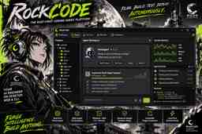

# RockCode

**Rust-first autonomous coding and engineering platform.**

RockCode is being designed as one reusable agent engine powering Windows Desktop, Web, CLI, and local/remote execution. It combines multi-agent orchestration, extensible tools and plugins, coding workflows, workspace isolation, and remote workers behind shared contracts.

> **Project status:** M1.1 contract-validation tooling is being established. The product runtime, execution workers and Desktop/Web applications have not started implementation. The specifications describe proposed design decisions, not shipped capabilities.

## Product surfaces

- **Desktop:** Windows-first Tauri 2 application with a React interface.
- **Web:** React + Vite control center for local and remote RockCode servers.
- **CLI/TUI:** Rust client using the same session and protocol contracts.
- **Agent Server / Workers:** Headless Rust runtime with local, container, and remote execution backends.

## Architecture principles

1. **One engine, multiple clients.** Agent loop, session lifecycle, tool dispatch, policy, context management, and persistence semantics live outside the UI.
2. **Rust-first runtime.** The kernel, orchestration, server, execution control, and security-sensitive boundaries are implemented in Rust.
3. **Local-first, remote-ready.** Single-user desktop mode works locally; remote mode adds identity, multi-user isolation, durable jobs, and worker orchestration.
4. **Policy is not a sandbox.** Permission decisions and OS/container isolation are independent enforcement layers.
5. **Explicit contracts.** Versioned HTTP APIs, event schemas, SDKs, plugin ABI, and persistence migrations are treated as product interfaces.
6. **Composable extensions.** Capability-scoped WASM/WIT plugins, MCP integrations, skills, and provider adapters extend the platform without coupling the kernel to implementations.

## Visual concept — Desktop application

The poster below is an **early visual direction**, not a screenshot of an implemented application. It communicates the intended RockCode identity: Industrial Grunge × Manga Linework × Funky Gen-Z, using the Moonframe Moonpunk visual foundation.

[Open the poster asset](assets/concept/rockcode-desktop-poster.jpg)

## Specification pack

The current architecture baseline is maintained in [`docs/specs/`](docs/specs/):

| Document | Purpose |
|---|---|
| [01 — Feature Parity Matrix](docs/specs/01-feature-parity-matrix.md) | Evidence-oriented comparison of upstream coding-agent projects and target capability tiers. |
| [02 — Gap Analysis](docs/specs/02-gap-analysis.md) | Missing capabilities, risks, priorities, acceptance criteria, and implementation gates. |
| [03 — Final Architecture Specification](docs/specs/03-final-architecture-specification.md) | Proposed system architecture, Rust crate boundaries, domain model, protocol, storage, execution, plugins, security, clients, and roadmap. |
| [04 — UI Design System](docs/specs/04-ui-design-system.md) | Industrial grunge × manga linework × funky Gen-Z direction, Moonframe integration, skins, layout, interaction, accessibility, motion, and visual QA. |
| [05 — UI Package Architecture](docs/specs/05-ui-package-architecture.md) | Moonframe dependency, RockCode UI packages, component inventory, workbench, editor/terminal adapters, and UI implementation gates. |
| [M1.1 — Contract Validation Tooling](docs/specs/m0/M1.1-contract-validation.md) | Local and CI contract validation runner, pinned validators, positive/negative JSON fixtures, and GitHub Actions. |
| [M0 Architecture & Contracts](docs/specs/m0/README.md) | System context, crate boundaries, REST/WS protocol, domain invariants, threat model, platform matrix, Moonframe consumption, machine schemas, and POC gates. |
| [Specification Pack README](docs/specs/README.md) | Scope, governing decisions, status, and limitations of the documents. |

## Initial technology direction

| Area | Proposed baseline |
|---|---|
| Core/runtime | Rust stable + Tokio |
| HTTP/WebSocket | Axum + Tower |
| Desktop | Tauri 2 + React + TypeScript |
| Web | React + TypeScript + Vite |
| CLI/TUI | Rust + Clap + Ratatui/Crossterm |
| Local persistence | SQLite |
| Remote persistence | PostgreSQL + S3-compatible object storage |
| Plugin runtime | Wasmtime + WebAssembly Component Model (WIT) |
| Observability | tracing + OpenTelemetry |

These are architecture proposals and are subject to proof-of-concept validation before production adoption. The shared UI foundation is the existing [Moonframe UI](https://github.com/bjo163/moonframe), with RockCode-specific composition packages documented in [04](docs/specs/04-ui-design-system.md) and [05](docs/specs/05-ui-package-architecture.md).

## Upstream research references

RockCode's research baseline studies these projects as references, not as codebases to merge wholesale:

- [DeepSeek Harness](https://github.com/deepseek-ai/deepseek-harness)
- [OpenCode](https://github.com/anomalyco/opencode)
- [Goose](https://github.com/aaif-goose/goose)
- [Codex](https://github.com/openai/codex)
- [Drift](https://github.com/kylepelham/Drift)
- [Agent Code](https://github.com/avala-ai/agent-code)
- [OpenHands Agent Canvas](https://github.com/OpenHands/OpenHands)
- [OpenHands Software Agent SDK](https://github.com/OpenHands/software-agent-sdk)
- [OpenHands Automation](https://github.com/OpenHands/automation)

Upstream features, release status, licensing, and security posture must be revalidated against exact commits before code is adopted. The parity matrix records the audit snapshot and evidence limits.

## Development status

- [x] Initial upstream architecture research
- [x] Feature parity matrix
- [x] Gap analysis
- [x] Proposed final architecture specification
- [x] M0 system, domain, protocol, security, platform and UI dependency contracts authored
- [ ] Validate OpenAPI, AsyncAPI and JSON Schemas with pinned validators
- [ ] Validate Rust crate boundaries with minimal proof of concept
- [ ] Freeze protocol and domain contracts
- [ ] Implement the Rust agent kernel
- [ ] Implement server, execution workers, and clients

No third-party source code has been copied into this repository as part of the initial specification upload.
