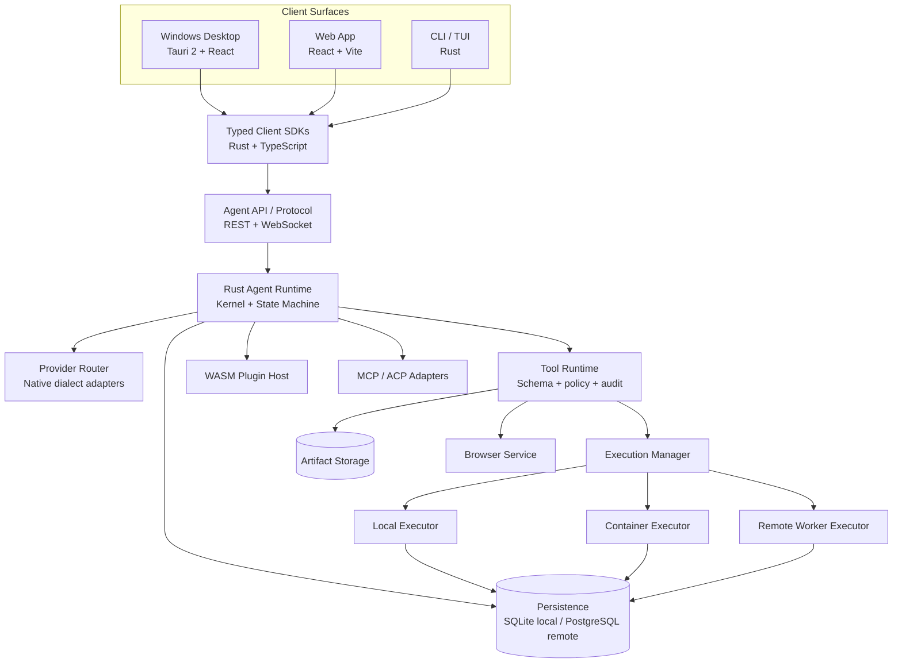
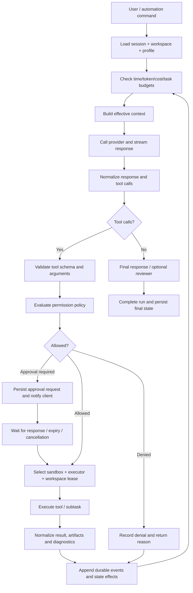

# 03 — Final Architecture Specification

**Project:** RockCode — Rust-first Autonomous Coding Agent Platform  
**Version:** 1.0 — Architecture baseline  
**Date:** 2 November 2026  
**Target:** Windows Desktop + Web + CLI + Local/Remote Execution  
**Status:** Proposed architecture baseline; implementation details must be validated with proof-of-concept and threat-model tests before production.

---

## 1. Product architecture decision

Build a new modular platform around a reusable Rust agent engine.

The platform has four product surfaces:

1. **Desktop:** Windows-first Tauri 2 application. The local agent engine can run in-process as a library or as a supervised local `agentd` process; the preferred first implementation is a local supervised server so Desktop and Web share the same protocol.
2. **Web:** React 19 + Vite application. It connects to a local or remote `agentd`/server and never executes shell commands inside the browser.
3. **CLI/TUI:** Rust terminal client using the same protocol and session model.
4. **Server/Worker:** headless Rust service and isolated execution workers for remote, containerized and hosted workspaces.

**Non-negotiable invariant:** Agent loop, session lifecycle, tool registry, permissions, executor selection, context management, and persistence semantics must not be reimplemented in individual clients.

## 2. System context



## 3. Deployment modes

### 3.1 Local Desktop mode

- Tauri starts or supervises a local `agentd` bound only to loopback.
- The local server creates a fresh per-launch secret/token and reports the connection endpoint to the trusted Tauri host.
- The browser/webview does not get unrestricted host access; all native operations cross typed Tauri commands or the authenticated local API.
- SQLite database and local artifacts live under the OS application data directory.
- Provider secrets live in the OS credential store; use Windows Credential Manager/DPAPI-backed storage where available.
- User explicitly selects the workspace root and execution policy.

### 3.2 Local Web development mode

- Vite serves the frontend.
- The Web client connects to a local `agentd` using an explicit pairing/auth flow.
- Local Web mode is a development convenience, not a public deployment mode.
- Browser local storage may keep a short-lived non-privileged UI session marker, but must not hold provider API keys or worker credentials.

### 3.3 Remote server mode

- Rust Agent Server runs as a service/container.
- PostgreSQL is the authoritative multi-user persistence store.
- Object storage stores large tool outputs, patches, screenshots, artifacts and logs.
- Remote execution uses separate worker processes/containers; the API server must not run arbitrary untrusted shell commands directly in its own host context.
- Web clients authenticate with user/device credentials and receive scoped session access.

### 3.4 Hybrid mode

- Desktop may connect to one or more remote servers and retain local projects.
- A session is explicitly bound to an execution environment/workspace; it must not silently change host or trust boundary when the client switches backend.
- Remote worker outages leave sessions resumable and clearly marked as disconnected/queued, not falsely completed.

## 4. Technology baseline

| Layer | Decision | Rationale / constraint |
|---|---|---|
| Core language | Rust stable | Runtime, execution, protocol server, storage and security-sensitive logic |
| Async runtime | Tokio | Task supervision, cancellation, streaming and network I/O |
| HTTP server | Axum + Tower | Typed routing, middleware, WebSocket and middleware composition |
| Serialization | Serde + JSON; schema generation | Stable API/event and persisted schema contracts |
| Desktop shell | Tauri 2 | Native Windows-first desktop with Rust host integration |
| Frontend | React 19 + TypeScript + Vite | Shared Desktop/Web UI and existing frontend ecosystem |
| Styling/UI | Moonframe-compatible token system; accessible primitives | Keep visual system independent from agent runtime |
| CLI/TUI | Clap + Ratatui or Crossterm | Consume shared protocol; no duplicate business logic |
| Local database | SQLite with WAL | Local-first single-user operation; use one logical writer per database |
| Remote database | PostgreSQL | Concurrent server workloads, multi-user authorization and durable jobs |
| DB access | SQLx or equivalent compile-time checked query layer | Avoid binding domain logic to ORM behavior; repository contracts isolate database implementation |
| Artifact storage | Local content-addressed files; S3-compatible object storage remotely | Large outputs/screenshots/diffs should not bloat event rows |
| Plugin runtime | Wasmtime + WebAssembly Component Model (WIT) | Capability-bounded extensions across supported languages |
| Browser | Browser service with CDP and WebDriver BiDi adapters | Own process lifecycle, tabs, screenshots, browser profiles and cleanup |
| Observability | tracing + OpenTelemetry | Correlation across client, runtime, tool and worker |
| API contract | OpenAPI for HTTP + versioned WebSocket event schema | Generated TypeScript client and compatibility tests |

Do not force the frontend runtime to be Node at production. Node is a build-time dependency for the React toolchain; the agent engine and server remain Rust.

## 5. Workspace and repository structure

```text
rockcode/
├── apps/
│   ├── desktop/                 # Tauri host + desktop entrypoint
│   ├── web/                     # React/Vite browser application
│   ├── agentd/                  # Local and remote Rust server binary
│   └── cli/                     # Rust CLI/TUI client
│
├── crates/
│   ├── agent-domain/            # IDs, canonical domain models, invariants
│   ├── agent-kernel/            # Run/turn/step state machine and orchestration contracts
│   ├── agent-runtime/           # Runtime supervisor, cancellation, lifecycle
│   ├── agent-models/            # Canonical message/content/provider capability models
│   ├── agent-providers/         # Native provider adapters and dialect implementations
│   ├── agent-router/            # Provider/model selection, fallback, limits and budgets
│   ├── agent-context/           # Token budgets, compaction, summaries and memory interfaces
│   ├── agent-sessions/          # Session, turn, message and snapshot services
│   ├── agent-events/            # Durable events, cursor replay, reducer and resync
│   ├── agent-tools/             # Tool schema, registry, dispatch and result normalization
│   ├── agent-permissions/       # User/org policy decision engine
│   ├── agent-execution/         # Executor traits, process jobs and worker routing
│   ├── agent-sandbox/           # OS/container enforcement providers
│   ├── agent-workspaces/        # Workspace roots, leases, mounts and environment metadata
│   ├── agent-vcs/               # Git operations, worktrees, diff and undo snapshots
│   ├── agent-lsp/               # Language server manager and diagnostics
│   ├── agent-browser/           # Browser session manager and CDP/BiDi drivers
│   ├── agent-computer/          # Optional computer-use capability broker
│   ├── agent-mcp/               # MCP client/server adapters and OAuth flows
│   ├── agent-acp/               # Agent Client Protocol adapter
│   ├── agent-plugins/           # WIT interfaces, Wasmtime host and plugin registry
│   ├── agent-skills/            # Skill discovery, validation and resolution
│   ├── agent-jobs/              # Background task graph and scheduler interfaces
│   ├── agent-storage/           # Repository interfaces, SQLite/Postgres adapters
│   ├── agent-credentials/       # Local credential store and remote vault interfaces
│   ├── agent-api/               # REST/WS API handlers and auth middleware
│   ├── agent-sdk/               # Public Rust SDK and stable façades
│   ├── agent-telemetry/         # Tracing, metrics and redaction
│   └── agent-evals/             # Eval fixtures, replay harness and conformance support
│
├── clients/
│   └── typescript-sdk/          # Generated API types + handwritten typed client
│
├── plugins/
│   ├── builtins/
│   ├── providers/
│   ├── tools/
│   ├── agents/
│   └── examples/
│
├── specs/
│   ├── architecture/
│   ├── domain-model/
│   ├── protocol/
│   ├── runtime/
│   ├── providers/
│   ├── tools/
│   ├── execution/
│   ├── sandbox-security/
│   ├── plugins/
│   ├── desktop/
│   ├── web/
│   ├── persistence/
│   ├── operations/
│   └── testing/
│
├── docs/
├── scripts/
└── Cargo.toml
```

### 5.1 Crate dependency rules

1. `agent-domain` must be dependency-light and cannot depend on network, UI or persistence crates.
2. `agent-kernel` depends on domain contracts and traits, not concrete providers, DB or executor implementations.
3. `agent-runtime` composes implementations and owns lifecycle/supervision.
4. `agent-api` translates transport commands/events to runtime operations; it does not implement agent logic.
5. `agent-storage` implements repository traits; domain and kernel do not issue SQL.
6. `agent-execution` defines executor contracts; platform-specific sandbox implementations sit below it.
7. `agent-plugins` can call only explicitly registered host capabilities.
8. Desktop/Web/CLI depend on protocol/SDK, never on internal runtime crates.
9. Optional heavy capabilities (browser, voice, image generation, local inference) must be feature-gated or separate services.
10. Avoid circular dependencies; use domain-owned traits and narrow adapter crates.

Do not automatically create a Cargo crate for every folder. Split when ownership, dependency direction, release lifecycle or optionality justifies it.

## 6. Core domain model

### 6.1 Entities

| Entity | Purpose | Important fields |
|---|---|---|
| Organization | Remote tenant boundary | `id`, `plan`, `policy_id`, `created_at` |
| User | Human identity | `id`, `org_id`, `role`, `status` |
| Device | Trusted client/device | `id`, `user_id`, `public_key`, `revoked_at`, `last_seen_at` |
| Workspace | Isolated project environment | `id`, `owner_id`, `executor_id`, `root_uri`, `lease_id`, `status` |
| Project | Logical repository/project metadata | `id`, `workspace_id`, `repo_uri`, `default_branch`, `settings_version` |
| Session | Durable conversation and run context | `id`, `workspace_id`, `owner_id`, `agent_profile_id`, `status`, `created_at` |
| Message | Canonical conversation item | `id`, `session_id`, `role`, `content`, `visibility`, `created_at` |
| Run | One user-triggered execution lifecycle | `id`, `session_id`, `status`, `budget`, `started_at`, `finished_at` |
| Turn | A model/tool iteration group | `id`, `run_id`, `sequence`, `status` |
| Step | One agent operation/inference/tool orchestration unit | `id`, `turn_id`, `kind`, `status` |
| ToolCall | Structured invocation and result | `id`, `step_id`, `tool_id`, `input_ref`, `output_ref`, `status` |
| ExecutionJob | Process/command/browser work on an executor | `id`, `workspace_id`, `executor_id`, `lease_id`, `status` |
| Approval | Human/policy decision | `id`, `subject`, `scope`, `decision`, `expires_at`, `actor_id` |
| Event | Durable state transition/audit record | `id`, `aggregate_id`, `seq`, `type`, `schema_version`, `payload_ref`, `created_at` |
| Snapshot | State checkpoint for hydration | `id`, `aggregate_id`, `last_seq`, `schema_version`, `state_ref` |
| AgentProfile | Agent role/system prompt/tool set | `id`, `version`, `model_policy`, `tool_policy`, `prompt_ref` |
| AgentTask | Parent-child task graph node | `id`, `parent_task_id`, `session_id`, `depends_on`, `budget`, `status` |
| Plugin | Installed extension metadata | `id`, `version`, `digest`, `source`, `grants`, `enabled` |
| Skill | Reusable instructions and assets | `id`, `version`, `source`, `trust_level`, `content_ref` |
| Artifact | Large file/result/screenshot/diff | `id`, `workspace_id`, `kind`, `digest`, `storage_uri`, `size` |

### 6.2 State model

- A **Session** survives app restarts and can contain multiple Runs.
- A **Run** is initiated by a user, automation or parent agent.
- A **Turn** contains model inference and associated tool work.
- A **Step** is the unit of state-machine progression and durable effects.
- A **ToolCall** is never treated as complete until its result/failure/cancellation state is persisted.
- A **Task** is a schedulable/observable piece of work; a subagent can own a child session and task.
- An **ExecutionJob** is an executor-owned unit, not merely a shell command string in chat history.

### 6.3 Status enums

Use explicit versioned enums. Minimum session states:

`created`, `idle`, `running`, `waiting_approval`, `waiting_input`, `waiting_child`, `queued`, `disconnected`, `completed`, `failed`, `cancelled`, `archived`.

Minimum tool/execution states:

`pending`, `validating`, `awaiting_policy`, `awaiting_approval`, `queued`, `starting`, `running`, `streaming`, `succeeded`, `failed`, `timed_out`, `cancel_requested`, `cancelled`, `lost`, `recovered`.

Never infer completion solely because a WebSocket closed or a client disconnected.

## 7. Agent kernel and runtime specification

### 7.1 Turn lifecycle



### 7.2 Kernel responsibilities

- Determine the next operation from the persisted session state.
- Assemble model input from message history, project instructions, profile, skills, tool schemas, memory and provider-specific request metadata.
- Call model provider through a capability-aware adapter.
- Normalize model output while preserving provider metadata that affects behavior.
- Dispatch tool calls through the centralized pipeline.
- Apply tool outputs and state effects idempotently.
- Manage retries, max-turn rules, cancellation, context compaction, delegation and finalization.
- Emit typed events for every meaningful state transition.

### 7.3 Kernel non-responsibilities

- No direct SQL.
- No direct `std::process::Command` or shell spawning outside executor adapters.
- No HTTP route definitions.
- No desktop UI state.
- No direct credential persistence.
- No implicit plugin code execution.
- No assumption that a model's instruction to perform an action is authorization.

### 7.4 Operation/effect model

Use a composable pipeline inspired by Goose:

- `Operation::applies(context) -> bool`
- `Operation::prepare(context) -> OperationInput`
- `Operation::run(input, emitter, cancellation) -> OperationResult`
- `OperationResult` returns typed effects/events, not direct cross-subsystem mutations.
- Runtime validates/applies effects transactionally where possible.

Effects must have deterministic IDs or idempotency keys so a retry after a crash cannot duplicate a file operation, tool result or task notification.

### 7.5 Concurrency and cancellation

- Every Run and child Task receives a cancellation token and deadline.
- Parent cancellation propagates to children unless child is explicitly detached under policy.
- Every tool declares concurrency class: read-only parallel, workspace mutation serial, external side-effect serialized/idempotent, or isolated independent.
- Use per-workspace write locks/leases; never hold DB locks while waiting on providers, child processes or network calls.
- Enforce maximum parallel tools, subagent depth, children per parent, total active jobs, and aggregate cost/time budget.
- A lost worker must become `lost`/`recovering`, never `succeeded` by default.

## 8. Provider abstraction and LLM router

### 8.1 Provider contract

Create a stable `ProviderAdapter` contract with:

- Provider identity and configuration schema.
- Authentication strategy and credential reference (never raw credential in general config).
- Model catalog and model metadata.
- Supported content types and modalities.
- Tool/function calling capability and schema constraints.
- Streaming mode and event normalization.
- Reasoning/thinking options.
- Cache-control semantics.
- Token/usage reporting and pricing metadata.
- Rate limits, retry-after support and error classification.
- Context window, output limits and capability caveats.
- Request/response sanitization and request ID capture.

### 8.2 Provider adapter families

Initial implementation order:

1. OpenAI Responses API.
2. Anthropic Messages API.
3. OpenAI Chat Completions compatible endpoints.
4. Google Gemini API.
5. Ollama/local OpenAI-compatible API.
6. Additional cloud providers through native adapters where generic compatibility loses semantics.

Do not hard-code provider-specific model names in kernel logic. The catalog is data-driven and supports user-defined OpenAI-compatible endpoints.

### 8.3 Router responsibilities

- Resolve explicit provider/model overrides.
- Validate required capabilities before a task starts.
- Support primary/fallback model strategy.
- Distinguish retryable network/429/5xx errors from non-retryable authentication, invalid model or policy errors.
- Track request IDs, usage, cost estimates and rate-limit state.
- Keep account/subscription credentials separate from generic API keys.
- Never change a session's provider identity silently when resuming it; require a compatible migration or explicit user choice.

## 9. Context, memory and compaction

Context construction order:

1. System policy and platform invariants.
2. Agent profile and role prompt.
3. Organization/user policy and project instructions.
4. Active skills and relevant referenced documents.
5. Durable memory selected for the current workspace/project.
6. Recent conversation and tool history.
7. Relevant artifacts, diffs and diagnostics.
8. Tool definitions and provider capability instructions.

### Compaction stages

- **Microcompact:** replace oversized old tool outputs with durable artifact references while retaining call/result pairing.
- **Summarize:** generate structured summaries with open tasks, constraints, decisions, changed files, test outcomes and unresolved risks.
- **Collapse:** build a model-facing view of the conversation without deleting full persisted history.
- **Recover:** if a provider returns context-length errors, compact once using measured usage and retry with bounded attempts.

Memory must be distinct from conversation transcript. Track origin, scope, confidence, timestamps, expiry and deletion behavior. Never promote untrusted repository instructions or tool output into trusted system policy.

## 10. Tool runtime

### 10.1 Canonical tool contract

Each tool registers:

- Stable `tool_id` and version.
- JSON Schema input and output.
- Description and examples.
- Required capability grants.
- Risk class and side-effect class.
- Workspace/path/network/process scope requirements.
- Timeout and output-size limits.
- Concurrency class.
- Whether the tool can request user interaction.
- Audit and telemetry classification.

### 10.2 Mandatory dispatch pipeline

1. Resolve registered tool and version.
2. Validate input schema and size limits.
3. Resolve session, actor, organization and workspace.
4. Classify tool intent and target resources.
5. Evaluate policy (`allow`, `ask`, `deny`) with explicit rule precedence.
6. If approval is required, persist request and wait; expire or revoke deterministically.
7. Resolve sandbox profile and executor.
8. Execute with scoped credentials/environment and resource limits.
9. Stream stdout/stderr/progress through bounded channels.
10. Normalize result, truncate safely and externalize large output to artifacts.
11. Redact secrets and sensitive data.
12. Persist result, event and audit record.
13. Return the model-facing result separately from the UI-facing presentation.

No built-in tool or MCP tool may bypass this pipeline.

### 10.3 Minimum built-in coding tools

**P0:** `file.read`, `file.write`, `file.edit`, `file.list`, `search.grep`, `search.glob`, `shell.exec`, `process.output`, `process.stop`, `git.status`, `git.diff`, `git.log`, `task.list`, `task.update`, `question.ask`.

**P1:** `git.worktree`, `git.commit`, `git.branch`, `lsp.diagnostics`, `format.run`, `test.run`, `browser.open`, `browser.snapshot`, `browser.click`, `browser.type`, `browser.screenshot`, `review.diff`, `review.repository`.

**P2:** notebooks, image generation, voice, computer-use and advanced system integrations.

## 11. Permission and sandbox specification

### 11.1 Separate policy from enforcement

- **Policy engine:** decides whether an actor/session/profile may request a particular action and whether user approval is required.
- **Sandbox:** constrains what the process can actually access regardless of model intent or policy misclassification.
- **Executor:** launches and supervises the process inside the selected sandbox.
- **Audit service:** records policy decision, approval actor, sandbox profile, executor identity and result.

A policy `allow` must never widen the sandbox. A sandbox must not be used as a substitute for per-action approval.

### 11.2 Policy decisions

Canonical decisions:

- `allow` — policy allows the action inside the current sandbox.
- `ask` — require explicit user approval before starting the action.
- `deny` — block the action and return a reason.
- `require_stronger_sandbox` — the action cannot run in current sandbox, but may run in a more isolated executor if configured.

Rule precedence must be deterministic and documented. Explicit deny must dominate broad allow. Rules should bind to tool ID, canonical parsed command/invocation, workspace, path/resource, network destination, actor, project trust and scope.

### 11.3 Windows-first sandbox strategy

For Windows local execution, provide a pluggable backend. The initial release should prefer a container/VM/WSL2 isolation option for higher-risk or untrusted tasks. Native Windows support can incrementally add restricted tokens, Job Objects, filesystem ACL boundaries and AppContainer/network restrictions where supported and tested.

Do not describe a feature as sandboxed merely because it has a permission prompt or runs as a child process. If a requested isolation level is unavailable, reject or ask the user to choose a weaker, explicitly named mode; never silently downgrade.

### 11.4 Linux/macOS

- Linux: evaluate bubblewrap, Landlock and seccomp combinations with kernel capability detection.
- macOS: evaluate Seatbelt/sandbox-exec or a maintained supported native alternative.
- Each backend reports effective capabilities and limitations, not just a boolean `sandboxed` flag.

### 11.5 Secret handling

- Local: OS credential vault (Windows Credential Manager/DPAPI, macOS Keychain, Linux Secret Service or encrypted fallback).
- Remote: server-side encrypted vault with key rotation and access audit.
- Never expose provider credentials to browser JS, project plugin code or child processes unless an explicit scoped secret is granted.
- Environment variable allowlist by executor profile; sanitize inherited environment variables.
- Redact secrets from logs, events, artifacts, model context and error reports.

## 12. Workspace and executor architecture

### 12.1 Executor interface

`Executor` must support:

- `provision(workspace_spec)`
- `inspect(executor_id)`
- `execute(job_spec)`
- `stream(job_id, cursor)`
- `cancel(job_id)`
- `collect_artifacts(job_id)`
- `snapshot(workspace_id)` where supported
- `destroy(workspace_id)`
- `health()`

All methods are idempotent or use explicit idempotency keys where side effects are possible.

### 12.2 Initial executor implementations

1. `LocalExecutor`: desktop-local workspace and native process control, with platform sandbox provider.
2. `ContainerExecutor`: Docker/OCI container per workspace or job; non-root user; explicit mounts; resource/network limits.
3. `RemoteExecutor`: worker service with authenticated registration, leases, heartbeat, task pull/push, event stream and reconnect/resume.

### 12.3 Workspace isolation rules

- Each workspace has one explicit canonical root and policy.
- Each concurrent mutating agent gets a separate Git worktree or isolated copy by default.
- A project cannot self-authorize extra filesystem roots or plugin execution merely by including configuration files.
- Filesystem path resolution must defend against symlinks, junctions, case folding and race conditions on Windows.
- Workspace cleanup is lease-aware and cannot delete a still-running workspace.
- Artifacts use content hashes; workspace files remain within executor-owned roots.

## 13. Session persistence and event protocol

### 13.1 Storage architecture

| Mode | Database | Artifact store |
|---|---|---|
| Desktop/local | SQLite WAL | Local content-addressed files |
| Local headless | SQLite WAL | Local content-addressed files |
| Remote single-node | PostgreSQL recommended; SQLite only for controlled single-user installs | S3-compatible or local managed storage |
| Multi-worker hosted | PostgreSQL | S3-compatible object storage |

Use repository interfaces so domain services do not depend on SQLite or PostgreSQL APIs. SQLite and PostgreSQL need separate migration suites and conformance tests.

### 13.2 Durable event envelope

Every event has:

```json
{
  "event_id": "evt_...",
  "aggregate_type": "session",
  "aggregate_id": "ses_...",
  "seq": 124,
  "schema_version": 1,
  "type": "tool.execution.started",
  "occurred_at": "2026-11-02T00:00:00Z",
  "correlation_id": "corr_...",
  "causation_id": "evt_...",
  "payload": {}
}
```

Requirements:
- `seq` increases monotonically for each aggregate/session stream.
- Event append and corresponding durable state transition are committed atomically where possible.
- Event payloads are versioned; large content is referenced by artifact ID/digest.
- Snapshot stores the highest included sequence and schema version.
- Client can reconnect with the last applied cursor.
- If history is available, replay missing events.
- If cursor expired or server instance changed in a way that invalidates replay, send `resync` and require hydration from snapshot/current state.
- Duplicate event delivery is tolerated using `event_id`/`seq` de-duplication.
- The client advances its cursor only after applying the event.

### 13.3 WebSocket protocol

Use HTTP for CRUD and commands, WebSocket for live session events and interactive replies. Add SSE as an optional read-only compatibility transport where WebSocket is unsuitable; it must preserve the same event IDs and cursors.

Minimum routes:

- `POST /v1/sessions`
- `GET /v1/sessions`
- `GET /v1/sessions/{session_id}`
- `POST /v1/sessions/{session_id}/turns`
- `POST /v1/sessions/{session_id}/cancel`
- `POST /v1/sessions/{session_id}/steer`
- `POST /v1/approvals/{approval_id}/decision`
- `GET /v1/workspaces`
- `POST /v1/workspaces`
- `GET /v1/executors`
- `GET /v1/models`
- `GET /v1/plugins`
- `GET /v1/openapi.json`
- `GET /v1/events?session_id=...&cursor=...` (WebSocket upgrade)

Minimum WebSocket control frames:

- `hello {protocol_version, server_instance_id, current_seq}`
- `resync {current_seq, reason}`
- `approval.reply {approval_id, decision}`
- `question.reply {request_id, answer}`
- `command.result {request_id, ok, error?}`
- `heartbeat {timestamp}`

Minimum event families:

- `session.created`, `session.updated`, `session.archived`
- `run.started`, `run.progress`, `run.completed`, `run.failed`, `run.cancelled`
- `turn.started`, `turn.completed`
- `message.created`, `message.delta`, `message.completed`
- `tool.call.created`, `tool.execution.started`, `tool.output`, `tool.execution.completed`, `tool.execution.failed`
- `approval.requested`, `approval.resolved`, `approval.expired`
- `task.created`, `task.updated`, `task.completed`, `task.failed`
- `workspace.created`, `workspace.lease.changed`, `workspace.disconnected`
- `executor.connected`, `executor.disconnected`, `executor.job.updated`
- `artifact.created`, `diagnostic.created`

### 13.4 API compatibility

- Version public routes under `/v1`.
- Generate TypeScript request/response types from OpenAPI.
- Maintain a protocol compatibility test between current and previous supported client/server minor versions.
- Breaking event/schema changes require a version bump or explicit compatibility transform.
- ACP and MCP adapters translate to/from canonical internal models; neither becomes the internal source of truth.

## 14. Multi-agent orchestration

### 14.1 Model

- Orchestrator creates a task graph with dependencies and budgets.
- Each child task references an agent profile/role and may create a child session.
- Child sessions have isolated context and explicit workspace policy.
- Parent receives typed child progress and outcome events.
- A message board/inbox supports explicit agent-to-agent messages; do not share internal chain-of-thought or hidden reasoning. Share task status, evidence, artifacts, decisions and concise summaries.

### 14.2 Roles

Initial built-in profiles:

- `planner` — read-only by default; decomposes task and produces execution graph.
- `explorer` — read-only repository investigation.
- `implementer` — scoped code changes.
- `reviewer` — independent diff and requirement review.
- `tester` — runs focused checks and reports failures.
- `debugger` — investigates reproducible failures.
- `general` — flexible coding task under current policy.

Roles are configuration, not separate privileged binaries. Their tool grants and sandbox profiles remain explicit.

### 14.3 Concurrency policy

- Global max active child tasks.
- Per-session and per-workspace concurrency limit.
- Per-provider concurrency and rate-limit budget.
- Max delegation depth.
- Max tool calls/time/cost per task.
- Task lease and heartbeat.
- Deterministic cancellation and retry rules.
- Default worktree isolation for concurrent writes.

## 15. Plugin, skill and extension specification

### 15.1 Three distinct extension types

1. **Skills:** declarative instructions, references and static assets. They do not grant new system capabilities.
2. **MCP/ACP integrations:** protocol-based external tools/agents. Their calls are routed through the central policy and audit pipeline.
3. **WASM plugins:** executable extensions implementing WIT interfaces inside Wasmtime with explicit host grants.

### 15.2 Plugin manifest

Minimum manifest fields:

- `id`, `name`, `version`, `api_version`, `wit_version`
- `entrypoint`, `digest`, `signature`, `publisher`
- `capabilities_requested`
- `hooks_subscribed`
- `configuration_schema`
- `minimum_host_version`
- `permissions_description`
- `license`, `source`, `release_channel`

### 15.3 Host capability grants

No implicit grants. Example capability categories:

- `workspace.read` — scoped to declared workspace root.
- `workspace.write` — scoped path allowlist and explicit write grant.
- `process.exec` — fixed executable allowlist, args, timeout and sandbox profile.
- `network.fetch` — destination allowlist, request/response size limit, timeout.
- `secrets.read` — named secret references only; never enumerate all secrets.
- `notifications.send` — user-visible notification only.
- `session.read` / `session.annotate` — limited session metadata and annotations.

### 15.4 Plugin lifecycle

`discovered → validated → awaiting_trust → installed → enabled → initializing → active → disabled/error → removed`.

- Validate signature/hash and host/API compatibility before load.
- Project-level manifests may request plugin install but must not auto-execute plugin code.
- Show publisher, capabilities, file/network/process scopes and update history.
- A plugin hook timeout cannot grant extra access.
- Security enforcement hooks fail closed; advisory hooks may fail open only when they cannot affect authorization or data boundaries.
- Revoking a plugin terminates active plugin instances and invalidates granted tokens.
- Plugin registry supports pinning, rollback and vulnerability notices.

## 16. Browser and computer-use architecture

### 16.1 Browser service

The browser subsystem owns browser processes, contexts, tabs, profiles, downloads, screenshots, network logs and cleanup.

Driver interfaces:
- Chromium: Chrome DevTools Protocol.
- Firefox: WebDriver BiDi.
- Optional hardened browser distribution through a managed install flow.

Agent tools operate on semantic snapshots and stable element references; raw screenshot pixel clicking is a fallback, not the only interaction mode.

### 16.2 Isolation

- Browser profile is scoped to workspace/session and cannot silently share personal browser cookies.
- Browser network access follows executor network policy.
- Downloaded files become scoped artifacts or workspace files only through explicit bridge operations.
- Remote browser video/screenshot streams are authenticated and scoped to authorized viewers.
- Close/cleanup follows executor lease lifecycle.

### 16.3 Computer use

Computer-use support is a separate optional capability broker. It must request explicit screen/input accessibility permission, expose visible status, bind actions to a user/device session, and keep its authority independent from shell/file permissions.

## 17. Web and Desktop UI specification

### 17.1 Shared information architecture

- Workspace/project switcher.
- Session list, filters, search, archive and resume.
- Conversation timeline with streaming messages and tool cards.
- Task/subagent activity panel.
- Terminal panel with process lifecycle.
- Files panel and code/diff preview.
- Browser panel.
- Model/provider picker.
- Permission/approval center.
- Agent profile/skills/plugin configuration.
- Workspace/executor status.
- Settings, logs and diagnostics.

### 17.2 Client boundaries

- Desktop owns native file/folder picker, notifications, OS credential vault access, update mechanism and local service supervision.
- Web owns browser view state and remote client controls only.
- CLI owns terminal rendering and keyboard interaction only.
- All clients consume the same API and event model.

### 17.3 UI state rules

- Durable state comes from API/event stream.
- Ephemeral view state includes panel visibility, selected tab, unsent draft, layout and local filters.
- Optimistic updates are allowed only for reversible UI state or commands with idempotency keys.
- On reconnect, client resyncs from durable state before applying new live events.
- User sees whether a session is local, remote, queued, disconnected, waiting approval, running or completed.

### 17.4 Design requirements

- Premium developer workspace, not a generic chat clone.
- Compact/dense and comfortable layout modes.
- Keyboard-first command palette and shortcuts.
- Dark/light themes with consistent token semantics.
- Responsive browser and touch support.
- Accessible focus, keyboard navigation, contrast and screen-reader labels.
- Large transcript virtualization and bounded rendering.
- Tool output collapsible; raw output remains accessible and copyable.
- Clear separation between agent narrative, tool execution, policy approval, diagnostics and final results.

## 18. Authentication, authorization and remote trust

### Local
- Local daemon binds to loopback only.
- Fresh random token per launch, passed to trusted desktop host through a protected channel.
- Validate Host/Origin where applicable; use strict CORS and CSRF protections for browser access.
- Do not rely on loopback as the only trust signal.

### Remote
- TLS required; reverse-proxy forwarded headers must be trusted only from configured proxy addresses.
- Authentication via supported OIDC/device flow or secure first-party session.
- Short-lived access token and refresh token rotation.
- Device enrollment, device list and immediate revocation.
- RBAC roles: owner, admin, developer, viewer; task/tool permissions can be narrower than organization role.
- Every request is scoped to organization, user, workspace and session.
- Server-side provider secrets; clients hold only scoped access credentials.
- Rate limits, quotas and audit logs for session creation, shell execution, secret use, plugin install and remote access.

## 19. Observability and diagnostics

- Structured logs with correlation IDs: request → session → run → turn → tool call → executor job.
- OpenTelemetry traces for provider call, tool dispatch, process start, network and worker latency.
- Metrics for queue depth, active runs, tool success/failure, cancellation delay, provider error/rate limit, context tokens, estimated cost, executor utilization and reconnect/resync count.
- Default telemetry excludes prompt bodies, file contents, secrets and raw provider payloads.
- Optional high-fidelity completion logs are local-only by default and explicitly enabled.
- `agent doctor` checks environment, providers, workspace access, sandbox capability, DB migrations, protocol/server reachability and browser binaries.

## 20. Testing and quality gates

### 20.1 Test pyramid

- Unit: state machine reducers, provider mapping, policy precedence, path validation, token budgeting, plugin capability enforcement.
- Contract: OpenAPI, WebSocket schemas, ACP/MCP adapters, plugin WIT versions, provider capability conformance.
- Integration: SQLite/Postgres repositories, local/container/remote executors, tool pipeline, session recovery.
- End-to-end: Desktop and Web create/continue/cancel/resume the same session.
- Adversarial: prompt injection fixtures, malicious MCP tools, path traversal/symlink/junction escape, environment hijack, shell parsing ambiguity, plugin sandbox escape attempts, credential leakage.
- Performance: long transcripts, large tool outputs, hundreds of sessions, concurrent subagents and event replay.

### 20.2 Minimum release gates

- `cargo fmt --check`, `cargo clippy --workspace --all-targets -- -D warnings` (or documented exception list), `cargo test --workspace`.
- TypeScript typecheck, lint, unit and component tests.
- Build Tauri Windows x64 installer.
- Build Web production bundle.
- Build CLI binary.
- Database migrations up/down/restore tests.
- Protocol compatibility tests current/previous minor.
- Windows smoke test on clean Windows 10/11 environment.
- Sandbox conformance tests must pass before a sandbox mode is advertised as enforced.
- Dependency/license/SBOM and vulnerability scan.

No release note may claim a test, security audit or platform support unless CI evidence exists.

## 21. Non-functional requirements

| Area | Requirement |
|---|---|
| Reliability | Run/session state survives daemon restart; unfinished execution is detected and recovered or marked lost |
| Responsiveness | Streaming events delivered without blocking durable writes; large transcripts virtualized |
| Scalability | Provider calls, browser sessions, shell jobs and child agents have independent concurrency limits |
| Security | Least privilege, explicit trust boundaries, fail-closed sandbox enforcement and credential isolation |
| Portability | Windows x64 is first-class; Linux server is supported early; macOS support is added with a separately validated sandbox strategy |
| Maintainability | Stable crate ownership, generated client contracts, versioned schemas and migration tests |
| Extensibility | Plugins/tools/providers can be installed or disabled without modifying kernel code |
| Observability | Correlated traces and metrics without collecting sensitive prompt/file data by default |
| Accessibility | Keyboard-first and assistive-technology compatible client interactions |
| Data integrity | Idempotent events/effects, stable IDs, atomic writes and explicit migration contracts |

## 22. Implementation milestones and definition of done

### M0 — Specification baseline
- Finalize domain schema, crate dependency rules, API protocol, executor contract and threat model.
- Produce feature-to-module traceability map.
- Decide provider dialects, local DB and remote DB adapters.
- Produce Windows sandbox proof-of-concept matrix.

**Done when:** no unresolved cross-layer ownership, protocol or privilege-boundary ambiguity remains.

### M1 — Agent kernel vertical slice
- Rust kernel, state machine, one provider, streaming, file/shell tools, policy, local executor, SQLite, session recovery.
- Minimum enforceable Windows isolation profile before untrusted shell execution is enabled; if the supported platform cannot enforce the selected profile, keep shell execution disabled or require a clearly labeled trusted-local mode.

**Done when:** a sample coding task is fully replayable and resumable after daemon restart, and shell execution stays within the exact isolation level advertised by the application.

### M2 — Shared API and clients
- Axum API, WebSocket event cursor/replay, OpenAPI, TypeScript SDK, React Web, Tauri Desktop and CLI skeleton.

**Done when:** one session can be controlled from all three clients without client-side agent logic.

### M3 — Workspace and safety
- Hardened Windows sandbox backends, additional container/VM isolation options, credential vault, process manager, Windows-specific adversarial tests, Git worktrees, diff/undo.

**Done when:** high-risk execution is contained according to advertised sandbox capability, and platform limitations are detected rather than silently downgraded.

### M4 — Advanced coding tools
- LSP, formatter/test runner, browser service, code review, task tracker.

**Done when:** agent can implement, test, inspect browser output and report evidence of completion.

### M5 — Agents and extensions
- Subagents/task DAG, background workers, MCP/ACP, skills, WASM plugin host.

**Done when:** parent-child task recovery and plugin capability boundaries pass integration/security tests.

### M6 — Remote platform
- PostgreSQL, organization/user/device model, remote workers, container executor, artifact store, web remote backends.

**Done when:** multi-user authorization, tenant isolation, worker reconnection, audit and remote execution pass end-to-end tests.

### M7 — Ecosystem
- Automation service, plugin registry, evaluations, voice/computer use, analytics dashboard.

**Done when:** optional platform subsystems can be deployed/disabled independently and have documented operational limits.

## 23. Final architecture decisions summary

| Decision | Final baseline |
|---|---|
| Build vs fork | New implementation; upstream repositories are references and selective code may be adopted only after license/security review |
| Core language | Rust |
| Agent runtime | Reusable Rust library + supervised `agentd` binary |
| Desktop | Tauri 2 + React 19; Windows x64 first |
| Web | React 19 + Vite; shared TypeScript SDK |
| CLI | Rust client over shared protocol |
| API | Versioned REST + WebSocket; optional SSE read-only stream |
| Protocol compatibility | OpenAPI + versioned event schema; ACP/MCP adapters at boundaries |
| Local storage | SQLite WAL |
| Remote storage | PostgreSQL + S3-compatible artifact store |
| Execution | Local + OCI/Docker + remote worker executors |
| Sandbox | OS/container enforcement independent from permission decisions; fail closed |
| Plugins | WASM Component Model / WIT, capability-based host API |
| Providers | Native provider dialect adapters + capability-aware router |
| Event recovery | Durable monotonically sequenced events, cursor replay, snapshots and resync |
| Multi-agent | Task DAG + child sessions + workspace isolation + budgets |
| Browser | Dedicated service with CDP/BiDi drivers and scoped browser profiles |
| Testing | Unit + contract + integration + E2E + adversarial + platform conformance |

## 24. Source references

The architecture is informed by the following upstream implementations. These are references, not dependencies implied by this specification.

- [Goose Rust agent state machine](https://github.com/aaif-goose/goose/tree/main/crates/goose-agent)
- [Goose provider adapters](https://github.com/aaif-goose/goose/tree/main/crates/goose-providers)
- [Codex core and sandbox](https://github.com/openai/codex/tree/main/codex-rs/core)
- [Codex app-server](https://github.com/openai/codex/tree/main/codex-rs/app-server)
- [Codex execution server](https://github.com/openai/codex/tree/main/codex-rs/exec-server)
- [Drift engine architecture](https://github.com/kylepelham/Drift/blob/master/docs/engine.md)
- [Drift event replay implementation](https://github.com/kylepelham/Drift/blob/master/crates/drift-engine/src/api/events.rs)
- [Drift plugin WIT contract](https://github.com/kylepelham/Drift/blob/master/crates/drift-engine/wit/drift.wit)
- [Agent Code engine library](https://github.com/avala-ai/agent-code/tree/main/crates/lib)
- [OpenHands Agent Canvas architecture](https://github.com/OpenHands/OpenHands/blob/main/docs/architecture.md)
- [OpenHands Software Agent SDK](https://github.com/OpenHands/software-agent-sdk)
- [OpenHands Automation](https://github.com/OpenHands/automation)
- [OpenCode release/changelog](https://github.com/anomalyco/opencode/blob/dev/CHANGELOG.md)
- [DeepSeek Harness architecture](https://github.com/deepseek-ai/deepseek-harness/tree/master/docs)

---

**Implementation warning:** This document defines the target architecture and acceptance criteria. It does not certify upstream code, guarantee a Windows sandbox implementation, or authorize production deployment before the relevant tests and security reviews pass.