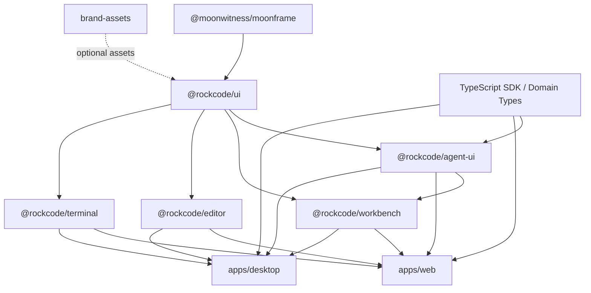

# 05 — RockCode UI Package Architecture & Component Specification

**Project:** RockCode — Rust-first Autonomous Coding Agent Platform  
**Version:** 1.0  
**Date:** 2 November 2026  
**Status:** Proposed package architecture; no UI package implementation created by this document  
**UI foundation:** `@moonwitness/moonframe` from [bjo163/moonframe](https://github.com/bjo163/moonframe)  
**Frontend:** React 19 + TypeScript + Vite; Tauri 2 for Desktop

---

## 1. Purpose

This specification defines how RockCode consumes Moonframe and builds its own engineering-specific UI packages without duplicating the existing design system.

It defines:
- package ownership and dependency direction;
- the public component API boundary;
- product-specific component inventory;
- shared Desktop/Web composition;
- editor and terminal adapter boundaries;
- style/theme integration;
- accessibility and event-state contracts;
- package quality gates and delivery sequence.

This is a source architecture, not a command to generate all packages immediately. Implement packages incrementally after contracts and consumer proofs pass.

---

## 2. Canonical dependency and ownership

### 2.1 Moonframe is the foundation, not a fork

The RockCode UI stack consumes:

- `@moonwitness/moonframe` — common React components, semantic styling, theme runtime, skin catalog, CSS and Tailwind bridge.
- RockCode UI packages — product-specific composition and engineering-domain widgets.
- App feature modules — route-level data fetching, permissions display, client orchestration and product navigation.
- Rust API/TypeScript SDK — commands, durable events and domain types.

Repository references:
- [Moonframe source](https://github.com/bjo163/moonframe)
- [Moonframe Design System Bible](https://github.com/bjo163/moonframe/blob/main/docs/moonframe-ui-design-system-bible-v1.3.md)
- [Moonframe package architecture](https://github.com/bjo163/moonframe/blob/main/docs/architecture/package-architecture-dx-bible.md)
- [Moonframe runtime usage](https://github.com/bjo163/moonframe/blob/main/docs/runtime-usage.md)
- [Moonframe implementation evidence](https://github.com/bjo163/moonframe/blob/main/docs/implementation-status.md)

Audited source baseline: `0e395f21edef0f01c42caeea34840bdcb71eeabf`. The root package manifest identifies `@moonwitness/moonframe@0.1.1`. The documentation inspected during this audit says npm publication has not been verified and documents local tarball consumption. Verify registry availability before selecting an npm version.

### 2.2 Dependency pinning policy

Until a verified registry release is available:
- consume Moonframe from an exact Git commit (or another reviewed immutable source reference);
- do not depend on a floating branch or tag;
- record the resolved SHA in the lockfile and dependency inventory;
- run a clean consumer install/build before every dependency update;
- run visual, accessibility and theme compatibility checks before merging an update.

A source update to Moonframe must not be made automatically just because upstream `main` moved.

### 2.3 No duplicate responsibilities

| Responsibility | Canonical owner | RockCode rule |
|---|---|---|
| Tokens and skin recipes | Moonframe | Never duplicate primitive/semantic palette values |
| Light/Dark/System resolver | Moonframe | No second ThemeProvider or preference resolver |
| Generic React controls | Moonframe | Compose existing controls before adding wrappers |
| Generic accessibility semantics | Moonframe | Preserve shared behavior; test RockCode compositions |
| RockCode brand identity | RockCode UI assets | Original assets, separate manifest and provenance |
| Agent/session/approval widgets | RockCode Agent UI | Render typed models; no authority or execution logic |
| Workbench shell/layout | RockCode Workbench | Layout, pane docking and view composition only |
| Editor/terminal implementations | RockCode adapters | Encapsulate vendor APIs and lifecycle |
| Backend commands/events | Rust API + TypeScript SDK | UI sends commands and renders canonical events |
| Authorization/policy | Rust backend | UI may display a decision but never grant authority |

---

## 3. Package topology

### 3.1 Proposed packages

Start with a small package set in the RockCode pnpm workspace.

| Package | Path | Responsibility | Dependency policy |
|---|---|---|---|
| `@rockcode/ui` | `packages/ui` | RockCode brand integration, application shell pieces, global navigation, reusable layout and status components | Peer dependency on React/React DOM and Moonframe |
| `@rockcode/agent-ui` | `packages/agent-ui` | Session timeline, messages, tool activity, approvals, run/task status, agent and model views | Depends on `@rockcode/ui`; consumes typed client/domain contracts |
| `@rockcode/workbench` | `packages/workbench` | Multi-pane workspace, dock, tab model, pane registry, layout persistence adapter | Depends on UI and Agent UI; no editor/terminal runtime in core |
| `@rockcode/editor` | `packages/editor` | Editor host adapter and RockCode editor-facing components | Optional, lazy-loaded editor vendor dependency |
| `@rockcode/terminal` | `packages/terminal` | Terminal host adapter, terminal tabs, process lifecycle visualization | Optional, lazy-loaded terminal vendor dependency |
| `@rockcode/brand-assets` | `packages/brand-assets` | RockCode logo, marks, original manga linework, industrial motifs and manifests | Static assets; no runtime requirement for core UI |
| `@rockcode/ui-testkit` | `packages/ui-testkit` | Shared fixtures, fake events, accessibility helpers, deterministic component test utilities | Development/test dependencies only |

**Do not create a package for every component category.** The table describes logical ownership and proposed package boundaries. If the editor/terminal adapters remain small, they may initially live as private modules and be split only when independent lifecycle, dependency size or ownership justifies it.

### 3.2 Proposed directory layout

```text
rockcode/
├── apps/
│   ├── desktop/                     # Tauri host; consumes shared UI packages
│   ├── web/                         # Browser application; consumes same UI packages
│   ├── agentd/                      # Rust headless server
│   └── cli/                         # Rust CLI/TUI
│
├── clients/
│   └── typescript-sdk/              # Generated API types + typed client
│
├── packages/
│   ├── ui/
│   │   ├── src/
│   │   │   ├── brand/
│   │   │   ├── shell/
│   │   │   ├── navigation/
│   │   │   ├── layout/
│   │   │   ├── status/
│   │   │   ├── overlays/
│   │   │   ├── settings/
│   │   │   ├── theme/
│   │   │   └── index.ts
│   │   └── package.json
│   │
│   ├── agent-ui/
│   │   ├── src/
│   │   │   ├── session/
│   │   │   ├── transcript/
│   │   │   ├── tool-activity/
│   │   │   ├── approvals/
│   │   │   ├── tasks/
│   │   │   ├── agents/
│   │   │   ├── models/
│   │   │   ├── context/
│   │   │   └── index.ts
│   │   └── package.json
│   │
│   ├── workbench/
│   │   ├── src/
│   │   │   ├── layout/
│   │   │   ├── panes/
│   │   │   ├── tabs/
│   │   │   ├── docking/
│   │   │   ├── persistence/
│   │   │   └── index.ts
│   │   └── package.json
│   │
│   ├── editor/
│   ├── terminal/
│   ├── brand-assets/
│   └── ui-testkit/
│
├── docs/
└── pnpm-workspace.yaml
```

### 3.3 Package dependency graph



Rules:
1. No circular dependencies.
2. `@rockcode/ui` cannot depend on `@rockcode/agent-ui`, workbench or app routes.
3. `@rockcode/agent-ui` may consume protocol/domain types but never a Rust runtime crate.
4. `@rockcode/workbench` owns layout and pane registration, not data-fetching or agent logic.
5. Editor and terminal are optional adapters; base UI must work when they are not installed.
6. Apps compose packages; packages must not import app source.
7. Brand assets are optional and cannot be required for content legibility.
8. Testkit is development-only and must never enter production dependency graphs.

---

## 4. Styling, theme and CSS integration

### 4.1 Single stylesheet owner

The application entrypoint imports Moonframe CSS once:

```ts
import '@moonwitness/moonframe/styles.css';
```

If the product uses Tailwind CSS v4, import the Moonframe bridge in the correct stylesheet order as documented by Moonframe:

```css
@import 'tailwindcss';
@import '@moonwitness/moonframe/tailwind.css';
```

The exact integration order must be validated against the pinned Moonframe CSS and Tailwind version. Avoid importing the same global CSS from every package.

### 4.2 Theme provider composition

The root app uses Moonframe's public theme exports. A RockCode provider may compose product context (workspace layout, UI preferences, command registry) around Moonframe's ThemeProvider, but it must not implement a second skin/mode resolver.

Conceptual root:

```tsx
import {
  ThemeProvider,
  ToastProvider,
} from '@moonwitness/moonframe';
import '@moonwitness/moonframe/styles.css';

export function RockCodeRoot({ children }: React.PropsWithChildren) {
  return (
    <ThemeProvider
      defaultSkin="moonpunk"
      defaultMode="dark"
      syncDocumentElement
    >
      <ToastProvider>{children}</ToastProvider>
    </ThemeProvider>
  );
}
```

This is a proposed integration example. Verify actual exported signatures and browser/Tauri runtime behavior against the exact pinned source before implementation.

### 4.3 Theme preference data

RockCode stores only the app-level preference if required by its product profile and passes the requested preference to Moonframe's resolver. Do not create a competing key with overlapping semantics.

Keep these axes independent:
- skin;
- appearance mode;
- density;
- motion;
- contrast;
- optional decoration preference.

User settings may be synchronized to remote profile storage only through an explicit product contract. A server-supplied workspace policy must not silently override local accessibility preferences.

### 4.4 No hard-coded app palette

- No raw hex values in product components.
- No per-skin duplicate CSS file authored by RockCode.
- No runtime construction of arbitrary Tailwind class names from API values.
- All product status colors use named semantic status roles.
- Domain-specific colors (diff, task state, worker state) must work in grayscale/forced-colors and have labels/icons.

---

## 5. Package public API and component catalogue

The following catalogue defines responsibilities and contract families. It does not require every item to become a component; a component must be created only when it has reusable behavior or composition value.

### 5.1 `@rockcode/ui` — base RockCode application UI

| Component / group | Purpose | Contract notes |
|---|---|---|
| `RockCodeProvider` | Composition root for app-level UI contexts | Wrap Moonframe provider; never duplicate theme state |
| `RockCodeShell` | Shared app shell | Slots for global rail, workspace nav, main view, inspector and status strip |
| `GlobalRail` | Primary navigation and global actions | Accessible labels and keyboard navigation |
| `WorkspaceSidebar` | Project/workspace/session navigation | Virtualized long lists; selected state not color-only |
| `WorkbenchHeader` | Workspace, repository, branch, executor and run context | Stable responsive collapse rules |
| `PaneFrame` | Common pane title/actions/resize affordances | Keyboard and pointer resize support |
| `InspectorPanel` | Right-side contextual information | Hide/show and focus restoration |
| `BottomDock` | Terminal/process/queue/problems/logs container | Tab selection and persisted layout state |
| `StatusStrip` | Workspace, branch, executor, connection and health summary | Text + semantic icon; no animation-only status |
| `WorkspaceSwitcher` | Select current workspace | Displays host/executor boundary |
| `ServerSwitcher` | Select local/remote agent server | Show identity and trust state |
| `ProjectBadge` | Repository and branch identity | Truncation with accessible full value |
| `ConnectionStatus` | Online/reconnecting/offline server state | Reflect actual transport events |
| `SectionHeading` | Page and pane heading recipe | Semantic heading level |
| `EmptyWorkspace` | First-run and no-project state | Optional manga illustration slot |
| `DecorativeMark` | Original brand/linework slot | Decorative only; hidden from AT |
| `AppearanceSettings` | Skin/mode/density/motion/contrast controls | Delegate skin/mode logic to Moonframe |
| `CommandLauncher` | App-level command palette integration | Uses Moonframe command palette behavior or approved adapter |

Use Moonframe's Button, Input, Field, Dialog, Drawer, Tabs, Table, Badge, Alert, Progress, Toast, CommandPalette, Skeleton, EmptyState and other primitives directly wherever they satisfy the requirement. A RockCode wrapper must add meaningful product behavior, not just rename a generic component.

### 5.2 `@rockcode/agent-ui` — agent and session components

| Component / group | Purpose | Required states |
|---|---|---|
| `SessionHeader` | Session name, workspace, agent profile, model and run controls | idle, running, waiting, completed, failed, disconnected |
| `SessionTimeline` | Ordered conversation and event presentation | initial, streaming, replaying, partial, stale, empty |
| `MessageBlock` | User, assistant, system and tool-related content | normal, streaming, edited, truncated |
| `ReasoningDisclosure` | Provider/model-returned summary or activity disclosure when available | collapsed, expanded, unavailable |
| `ToolCallCard` | Tool input/output, duration, status and artifacts | queued, running, waiting, success, error, cancelled |
| `ToolResultViewer` | Bounded text/JSON/diff/image/artifact preview | truncated, expanded, download-only, failed |
| `PermissionRequestCard` | Exact action and policy request | pending, approved, denied, expired, cancelled |
| `RunControls` | Start, stop, steer, retry, resume | enabled/disabled based on server capability |
| `AgentComposer` | Prompt editor, attachments, mentions, mode/profile selection | idle, submitting, disabled, validation error |
| `AgentProfilePicker` | Select agent role/profile | current, unavailable, loading |
| `ModelPicker` | Select provider/model/reasoning profile | compatible, incompatible, loading, auth-required |
| `ContextBudgetMeter` | Context use and compaction status | normal, nearing limit, compacting, unknown |
| `UsageSummary` | Tokens, estimated cost and model usage | known, estimated, unavailable |
| `TaskGraph` | Parent/child tasks and dependencies | queued, running, blocked, completed, failed |
| `AgentWorkerCard` | Agent worker identity and assignment | starting, healthy, idle, stopping, lost |
| `EventStreamHealth` | Live/reconnecting/replay/resync indicator | connected, reconnecting, resync-required, offline |
| `ArtifactList` | Files, patches, screenshots and outputs created by a run | new, modified, removed, unavailable |
| `ApprovalHistory` | Decision audit history | approved, denied, expired, overridden by policy |

### 5.3 `@rockcode/workbench` — multi-pane workspace

| Component / service | Purpose |
|---|---|
| `WorkbenchLayout` | Orchestrates resizable pane regions |
| `PaneRegistry` | Registers pane type, title, icon, lazy loader and allowed regions |
| `DockLayout` | Bottom/right dock tabs, split groups and collapsible areas |
| `WorkspaceTabs` | Open file/session/task/browser tabs |
| `LayoutPresetPicker` | Coding, review, planning, monitoring and compact presets |
| `LayoutPersistenceAdapter` | Save/restore pane layout by device/workspace |
| `PaneCommandRegistry` | Keyboard commands for focus, resize, move and close |
| `FocusRegionManager` | Tracks focus transitions between editor, transcript and terminal |

Layout persistence stores UI layout only. It must not store agent authorization, session state or tool execution state.

### 5.4 `@rockcode/editor` — editor adapter

Responsibilities:
- Host a selected editor implementation behind a RockCode editor interface.
- Support file tabs, language mode, diagnostics, selection, search, navigation, diff and read-only review.
- Synchronize edits with workspace APIs; never write to the machine directly from arbitrary browser code.
- Support decorations for diagnostics and agent changes with accessible alternatives.
- Dynamically load the editor bundle and web workers.
- Expose a replaceable adapter contract to allow Monaco or another editor in the future.

Editor interfaces must not:
- execute code independently of the configured executor;
- store provider credentials;
- own session state;
- assume a local filesystem exists in the browser.

### 5.5 `@rockcode/terminal` — terminal adapter

Responsibilities:
- Host terminal rendering and input.
- Bind terminal instances to a server-side process/PTY ID.
- Stream output with backpressure and bounded scrollback.
- Support reconnect, process exit, resize, copy/paste and explicit terminate controls.
- Show executor identity and workspace boundary.
- Clean up event subscriptions and terminal processes on unmount/session termination according to server contracts.

Terminal UI must not spawn arbitrary shell processes directly from the browser. Process creation and authorization belong to the Rust execution subsystem.

### 5.6 `@rockcode/brand-assets` — original product identity

Suggested asset groups:
- RockCode wordmark and compact mark;
- application icon and favicon;
- industrial plate/registration-mark set;
- manga speed-line and impact-mark set;
- halftone/photocopy pattern set;
- empty-state illustration set;
- small workspace/worker visual marks;
- optional SFX only if separately approved.

Every asset must have provenance, rights status, intended usage, accessible treatment and optimized exports. Functional icons are not a substitute for labels.

---

## 6. Component data and interaction contracts

### 6.1 Components are views, not authority

RockCode UI packages must not own:
- tool permission evaluation;
- sandbox policy;
- provider credentials;
- LLM routing;
- executor selection policy;
- agent retry/cancellation decision logic;
- session persistence;
- workspace authorization.

They may invoke explicit typed commands supplied by the app/client layer and render authoritative backend state.

### 6.2 Props pattern

Components receive serializable view models and callbacks. They must not accept entire runtime objects or mutable server clients.

Example conceptual contract:

```ts
type RunStatus =
  | 'queued'
  | 'planning'
  | 'running'
  | 'awaiting_approval'
  | 'awaiting_input'
  | 'retrying'
  | 'cancelling'
  | 'cancelled'
  | 'completed'
  | 'failed'
  | 'disconnected'
  | 'recovering';

type ExecutorSummary = {
  id: string;
  kind: 'local' | 'container' | 'remote';
  displayName: string;
  trustBoundaryLabel: string;
  connected: boolean;
};

type ToolCallView = {
  id: string;
  name: string;
  summary: string;
  status: 'queued' | 'running' | 'succeeded' | 'failed' | 'cancelled';
  startedAt?: string;
  durationMs?: number;
  inputPreview?: unknown;
  outputPreview?: string;
  truncated?: boolean;
};

type PermissionRequestView = {
  id: string;
  title: string;
  exactAction: string;
  target: string;
  workspaceName: string;
  executor: ExecutorSummary;
  risk: 'low' | 'medium' | 'high' | 'unknown';
  expiresAt?: string;
  allowedDecisions: Array<'approve_once' | 'approve_session' | 'deny'>;
};
```

This is an illustrative UI view-model contract. The canonical domain/protocol schema lives in the API/specification layer; do not create a second incompatible status enum when protocol types are implemented.

### 6.3 Event-driven rendering

- UI reads a normalized event/view-model stream from the TypeScript SDK or app adapter.
- Event IDs, sequence cursors and session IDs remain attached to view data.
- Replay/resync events must not be rendered as duplicate tool calls or duplicate messages.
- A stale client must show a reconnection/recovery status and hydrate from the backend.
- Unknown future event types must be handled as an explicit unknown event, not crash the transcript.
- Streaming text updates must preserve scroll intent and selection.
- Tool output truncation must be visibly disclosed.

### 6.4 Commands

Only app-level feature controllers dispatch commands such as:
- start run;
- cancel run;
- steer run;
- answer question;
- resolve approval;
- retry failed step;
- open artifact;
- select model/profile;
- create or close workspace tab.

The component receives a typed callback such as `onCancelRun(runId)`. It does not import fetch clients or call Rust IPC directly.

---

## 7. Frontend workspace and tooling

### 7.1 Workspace policy

Use pnpm workspaces for frontend apps and reusable UI packages. Pin the package manager version in root `package.json` and commit the lockfile.

Root workspace should include:
- `apps/*`;
- `packages/*`;
- selected client SDK packages as needed.

Use TypeScript project references or another explicit typecheck graph. Do not create an Nx/Turborepo layer until measured build/release needs justify it.

### 7.2 Runtime and peer dependencies

- React and React DOM are peer dependencies for reusable React UI packages.
- Moonframe is a pinned dependency/peer integration following the chosen consumption strategy.
- Large editor/terminal/browser libraries are optional/lazy dependencies.
- Do not bundle a second copy of React or Moonframe CSS.
- UI packages cannot import Rust binaries, Tauri internals or server-only dependencies.
- No secret management package may expose keys to browser components.

### 7.3 CSS rules

- Import Moonframe stylesheet once in each app entrypoint.
- Import Moonframe Tailwind v4 bridge only where Tailwind is actually used.
- Package-local CSS must be namespaced and must not reset global base styles.
- Avoid global element selectors that alter third-party editor/terminal DOM.
- CSS tokens use semantic variables from Moonframe; app-specific layout vars use a RockCode prefix only for non-theme layout state.
- Use static, analyzable utility classes; never dynamically concatenate arbitrary color classes from user/server data.

### 7.4 Public exports

Prefer explicit package exports:
- package root for stable components;
- documented subpaths for high-cost adapters;
- no imports from private `src/internal` paths by consumers;
- no wildcard exports that make all source modules public accidentally.

Every export requires type declarations and an API test.

---

## 8. Component behavior, performance and accessibility

### 8.1 Behavior

- Same component semantics in Desktop and Web.
- Controlled/uncontrolled behavior must be explicit.
- Callback names describe semantic actions, not DOM events.
- Async loading/error/disabled states are consistent.
- A visual animation may never delay a real action.
- Focus management belongs to the primitive/component owner.
- No hover-only controls for essential actions.
- Confirm destructive or high-impact actions.

### 8.2 Performance

- Lazy-load editor, terminal, browser, graph and advanced visualization packages.
- Virtualize long session transcripts and large file trees.
- Memoize only where measurement shows need; avoid stale state bugs.
- Debounce search and resize work.
- Abort in-flight UI requests on unmount/navigation.
- Clean up WebSocket/event listeners, editor workers, terminal subscriptions, observers and timers.
- Theme changes must not remount editor or terminal instances.
- Large artifacts are previewed in bounded form and loaded on demand.

### 8.3 Accessibility gates

- Keyboard coverage for all controls and pane operations.
- Screen-reader labels for all icon-only controls.
- Focus order follows the visual pane sequence.
- Dialog/drawer behavior follows Moonframe and browser semantics.
- Non-color-only status indicators.
- Visible focus in all 15 skins that RockCode exposes.
- Reduced-motion and forced-colors tests.
- Reflow and text zoom tests.
- Live-region announcements are throttled and meaningful.
- Terminal/editor content has appropriate accessible alternatives.

---

## 9. Testing and visual QA strategy

### 9.1 Test layers

| Layer | Test scope | Required evidence |
|---|---|---|
| Unit | Formatting, reducers, status mapping, view-model logic, layout persistence | Deterministic tests |
| Component | Props, states, keyboard, ARIA, focus and async behavior | Component tests |
| Integration | Moonframe + RockCode package compatibility, SDK event adapter, Tauri bridge | Browser/integration test |
| Visual | Skin/mode, pane sizes, long content, loading/error/empty and streaming | Screenshot comparison + human review |
| Accessibility | Keyboard, screen reader spot checks, contrast, forced colors, reduced motion | Accessibility report |
| Performance | Virtualized transcript, large diffs, terminal stream, memory cleanup | Profiling report |
| Consumer | Clean install/build in both Web and Desktop apps | CI smoke test |

### 9.2 Required UI fixtures

- no workspace;
- large monorepo with long paths;
- long session with 10k+ events;
- multiple concurrent agents;
- tool call with huge/truncated output;
- pending high-risk permission request;
- worker disconnect/reconnect;
- replay/resync after missed events;
- failed model/provider and retry;
- large diff and binary artifact;
- LSP diagnostics;
- 20+ terminal processes;
- browser automation with multiple tabs;
- local/remote workspace switch.

### 9.3 Skin coverage

At minimum, release candidate visual tests include:
- Moonpunk Dark and Light;
- Mooncrash Dark and Light;
- Moonledger Dark and Light;
- Classic Dark and Light;
- compact/comfortable/spacious density;
- reduced motion;
- high contrast/forced colors;
- decoration-off state.

Because Moonframe is the canonical theme provider, any public release must verify all 15 skins × 2 modes for the components and screens RockCode officially supports. Do not claim the full matrix passes from a few screenshots.

---

## 10. Implementation milestones

### UI-M0 — Contract and dependency
- Pin Moonframe exact source version.
- Perform clean consumer install.
- Confirm exported APIs and CSS behavior.
- Agree component ownership and design profile.
- Approve RockCode brand asset requirements.

**Exit:** a clean Vite/React consumer can import Moonframe and render the chosen theme without CSS or hydration issues.

### UI-M1 — Shared foundation
- pnpm workspace package setup.
- `@rockcode/ui` package.
- Root provider composition.
- Shell, rail, sidebar, header, inspector, status strip.
- Appearance preferences integrated with Moonframe.

**Exit:** one shell runs in Web and Tauri with the same theme and navigation semantics.

### UI-M2 — Agent UI
- Session timeline.
- Message and tool activity cards.
- Composer.
- Run controls.
- Approval request view.
- Agent/model selectors.
- Context and usage meter.

**Exit:** typed mock event streams and live SDK events render equivalent UI states.

### UI-M3 — Workbench
- Pane registry.
- Resize/dock/split.
- Tabs and layout presets.
- Workspace persistence.
- Keyboard shortcuts and focus transitions.

**Exit:** layout survives app restart and viewport changes without corrupting session state.

### UI-M4 — Editor and terminal
- Editor adapter.
- Terminal adapter.
- Diff review.
- Diagnostics and process panel.
- Lazy loading and cleanup.

**Exit:** editor/terminal can mount/unmount/reconnect without leaking workers/process subscriptions.

### UI-M5 — Product polish
- Original brand/linework asset pack.
- Empty/onboarding/help screens.
- Visual QA across skins/modes.
- Reduced effects and sound preferences.
- Accessibility and performance review.

**Exit:** release evidence package complete; no asset or UI claim based solely on mockups.

---

## 11. Explicit anti-patterns

- Recreating Moonframe Button/Input/Dialog/Table/ThemeProvider as separate RockCode primitives without a proven gap.
- Hardcoding a second set of color tokens.
- Creating a 16th Moonframe skin for RockCode.
- Mixing Moonpunk and Mooncrash skin recipes within the same theme.
- Building agent state or permission logic into React components.
- Letting browser UI execute local shell commands.
- Bundling Monaco/xterm/browser runtime into initial app shell.
- Using manga images as backgrounds behind source code or terminal output.
- Flashing, glitching or shaking every status change.
- Treating screenshot similarity as proof of accessibility.
- Shipping unpublished/unverified assets or fonts without provenance.
- Assuming npm publication from a root package manifest alone.

---

## 12. Definition of done

RockCode UI architecture is ready for production implementation only when:

1. Moonframe is pinned to a reproducible source and consumer installation succeeds.
2. There is one canonical theme runtime and one semantic token owner.
3. Desktop and Web use the same RockCode UI packages and view-model contracts.
4. Agent UI has complete states for running, waiting, approval, cancellation, failure, reconnect and recovery.
5. Workbench layout is responsive, resizable, keyboard-operable and persisted without storing business/security state.
6. Editor and terminal are lazy-loaded, replaceable adapters.
7. Original assets have provenance and accessible fallback behavior.
8. Visual QA covers the supported skin/mode/density/accessibility matrix.
9. Component tests and clean consumer builds pass.
10. No UI component has authority to approve execution, alter sandbox policy or access provider secrets.

---

## 13. Related specifications

- [04 — RockCode UI Design System](04-ui-design-system.md)
- [03 — Final Architecture Specification](03-final-architecture-specification.md)
- [Moonframe UI Design System Bible](https://github.com/bjo163/moonframe/blob/main/docs/moonframe-ui-design-system-bible-v1.3.md)
- [Moonframe Package Architecture & DX Bible](https://github.com/bjo163/moonframe/blob/main/docs/architecture/package-architecture-dx-bible.md)
- [Moonframe Runtime Usage](https://github.com/bjo163/moonframe/blob/main/docs/runtime-usage.md)
- [Moonframe Component API](https://github.com/bjo163/moonframe/blob/main/docs/component-api-behavior-bible.md)
- [Moonframe repository](https://github.com/bjo163/moonframe)
