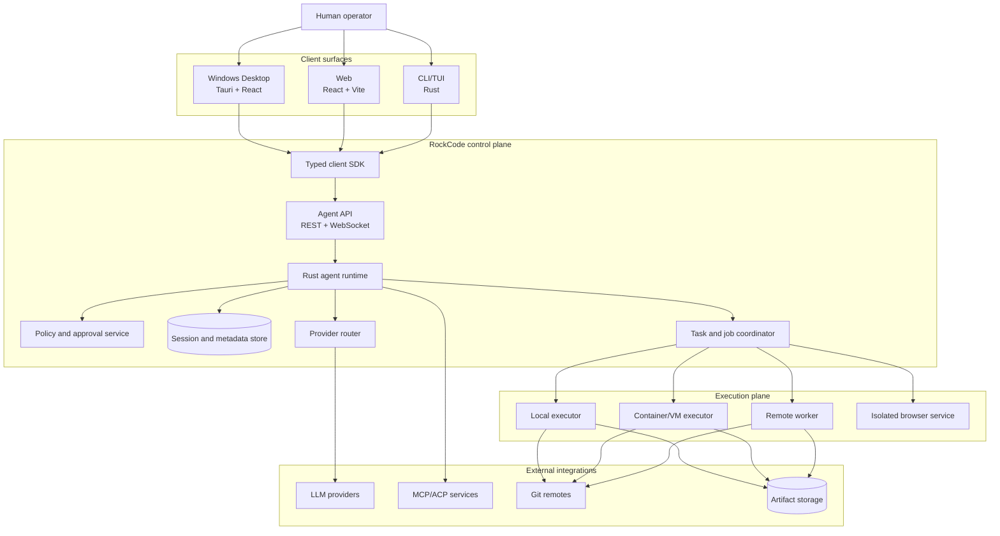

# M0-01 — System Context & Deployment Topology

**Status:** Normative architecture contract  
**Scope:** RockCode Desktop, Web, CLI, Agent Server, execution workers and integrations.

## 1. System objective

RockCode is one coding-agent platform with multiple clients and multiple execution placements. Desktop, Web and CLI must not implement separate agent loops or maintain divergent authoritative session state.

The system has two distinct planes:

- **Control plane:** identity, workspaces, sessions, agent orchestration, provider routing, tool policy, persistence, approvals, task scheduling, APIs and event delivery.
- **Execution plane:** process/PTY, filesystem mutation, Git operations, browser sessions, container/VM workloads and remote workers.

The control plane requests work from the execution plane through an authenticated executor contract. An API server must not become an unrestricted shell host.

## 2. System context



## 3. Trust boundaries

| Boundary | Trusted principal | Untrusted input / component | Required enforcement |
|---|---|---|---|
| B1 Client ↔ Agent API | Authenticated user/device | Browser, desktop UI, CLI input, stale clients | TLS remotely; local one-time bootstrap token; authn/authz; request limits |
| B2 Agent runtime ↔ model provider | Provider adapter and credential broker | Model output, tool calls, refusal text, provider metadata | Treat model output as untrusted data; validate tool schemas; central policy |
| B3 Runtime ↔ repository/workspace | Workspace service | Repository files, scripts, agent instructions, symlinks, generated content | Canonical path resolution, workspace ownership, sandbox mounts, no implicit trust promotion |
| B4 Runtime ↔ executor | Authenticated controller | Job payload, environment, command, artifacts | Versioned worker protocol, executor lease, scoped job token, resource limits |
| B5 Executor ↔ host OS | Sandbox supervisor | Source code, package scripts, child processes, downloaded binaries | OS/container/VM isolation; process tree limits; filesystem/network boundaries |
| B6 Runtime ↔ plugins/MCP | Plugin host and protocol adapter | Third-party executable code, remote tool output, manifests | Signed/hash-pinned packages, capability grants, policy pipeline, isolation |
| B7 Web UI ↔ browser storage | Authenticated frontend origin | XSS, malicious extensions, local storage exfiltration | No provider/worker secret in browser storage; CSP; secure cookies; origin controls |
| B8 Worker ↔ control plane | Enrolled worker identity | Network attacker, replay, compromised worker | Mutual/scoped credentials, heartbeat/lease, token rotation, event/job idempotency |
| B9 Tenant ↔ tenant | Authenticated organization membership | Object-ID guessing, shared worker leaks | Server-side tenant scoping at every repository/worker/artifact query |

## 4. Deployment modes

### 4.1 Desktop local mode

1. Tauri starts a supervised local `agentd` child process.
2. `agentd` binds only to loopback; it does not bind to `0.0.0.0`.
3. The host creates a short-lived per-launch bootstrap credential and passes it over a protected IPC/pipe or inherited handle, not via command-line argument or ordinary logs.
4. Tauri obtains an authenticated local API session and passes only the least-privilege session token to the webview/client bridge.
5. SQLite WAL and local content-addressed artifacts live in the OS application data directory.
6. Provider credentials are accessed through an OS credential vault or explicit credential broker.
7. Workspace root and execution profile are explicit and visible to the user.
8. Closing the UI does not silently erase a live session; process supervision policy determines whether the daemon continues, pauses or shuts down.

### 4.2 Local Web development

- Vite serves the UI independently.
- The browser connects to a local `agentd` through explicit pairing/trust.
- Local development mode is not a public deployment recipe.
- Browser JavaScript never reads provider keys, worker join tokens or host bootstrap credentials.
- CORS uses a strict origin allowlist; do not enable wildcard credentialed CORS.

### 4.3 Remote single-user server

- Agent API and runtime run under a dedicated service identity.
- PostgreSQL is the authoritative metadata/session database.
- Workers execute in separate containers/VMs or enrolled machines.
- Artifacts are stored in private object storage with scoped access.
- API host filesystem is not the project workspace by default.
- Remote access uses TLS, authenticated devices/users and revocable sessions.

### 4.4 Multi-user hosted mode

- Organization/user/device identity is required.
- Authorization is checked server-side on every resource and action.
- Workspace data, artifact metadata, provider credentials and execution leases are tenant-scoped.
- Workers receive scoped, short-lived job credentials; never a general API admin token.
- A worker is assigned to a tenant/workspace only through a durable lease and authorization check.

### 4.5 Hybrid mode

A Desktop user may use local and remote servers. Every session is explicitly bound to:
- server ID;
- workspace ID;
- executor ID and type;
- sandbox profile;
- credential scope;
- policy revision.

Switching server or executor creates an explicit transition or a new execution context. It must never silently move an active job across a trust boundary.

## 5. Runtime topology

### Local desktop

```text
Tauri Host
  ├─ Webview (React; presentation only)
  ├─ IPC bridge (typed, allowlisted commands)
  └─ Supervisor
       └─ agentd (Rust)
            ├─ SQLite
            ├─ local artifact store
            ├─ provider adapters
            ├─ policy and tool registry
            └─ local executor adapter
                 └─ sandboxed workspace process
```

### Remote deployment

```text
Browser / Desktop / CLI
          |
      TLS gateway
          |
     Agent API
          |
     Rust runtime
       /      \\
 PostgreSQL  Task coordinator
                  |
             Worker gateway
           /        |        \\
        Worker A  Worker B  Browser worker
           |        |          |
        Workspace / container / VM
                  |
           Private object store
```

## 6. Lifecycle contracts

### Server startup
- Verify data directory permissions and schema compatibility.
- Migrate database transactionally before accepting commands.
- Recover unfinished runs/jobs into `recovering`, `queued`, or `lost` according to executor lease evidence.
- Never mark an interrupted job `completed` during recovery.
- Bind listeners only after auth/token/bootstrap initialization succeeds.

### Server shutdown
- Stop accepting new runs.
- Signal cancellation or graceful checkpoint according to job policy.
- Flush event/store transactions.
- Preserve active executor leases until confirmed terminated or marked lost.
- Do not delete workspace data while a process may still use it.

### Worker disconnect
- Stop issuing new jobs to the worker.
- Mark heartbeat stale and lease state `suspect` before definitive `lost`.
- Reconcile job status with worker on reconnect.
- Prevent a second worker from taking a non-idempotent job while the previous lease may still be executing.

## 7. Deployment decisions locked for M0

| ID | Decision |
|---|---|
| SYS-001 | One Rust runtime, multiple clients |
| SYS-002 | Local Desktop uses supervised loopback `agentd` |
| SYS-003 | API/control plane and execution plane are separate trust domains |
| SYS-004 | Remote multi-user persistence uses PostgreSQL |
| SYS-005 | Large artifacts do not live in event payload rows |
| SYS-006 | Browser, editor, terminal and remote workers are lifecycle-managed services/adapters |
| SYS-007 | No public local API listener without explicit authenticated remote mode |
| SYS-008 | Execution host is never assumed to be the API host |

## 8. M0 acceptance evidence

- System context and trust-boundary review completed.
- Local Desktop startup/shutdown sequence has a sequence diagram and failure table.
- Remote worker enrollment/lease/reconnect sequence has a protocol owner.
- Threat model references each boundary by ID.
- No route, UI component or plugin is allowed to bypass the control plane or executor contracts.
