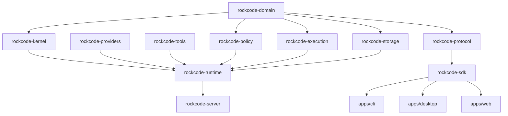

# M0-02 — Rust Crate Boundaries & Dependency Rules

**Status:** Normative dependency/ownership contract.  
**Implementation status:** No Cargo crates are created by this document.

## 1. Design goal

The Rust workspace must remain modular without fragmenting every module into its own crate. A crate is justified when it has at least one of:
- a stable public contract consumed by multiple applications;
- a distinct security boundary or privilege level;
- an independent platform-specific implementation;
- optional/heavy dependencies that should not be pulled into core;
- a separate release or testing lifecycle;
- a meaningful compile-time ownership boundary.

Otherwise keep it as a private module inside the owning crate.

## 2. Initial crate topology

### 2.1 Create at the first implementation boundary

| Crate | Owns | Must not own |
|---|---|---|
| `rockcode-domain` | IDs, canonical entities, enums, validated value types and domain errors | HTTP, SQL, provider SDKs, process spawning |
| `rockcode-kernel` | Run/turn/step orchestration traits, operation selection, state transition rules and typed effects | Concrete DB, HTTP server, concrete provider, UI, OS process |
| `rockcode-runtime` | Compose kernel services, supervise runs, cancellation, retries, recovery coordination | Route definitions, UI, raw credential storage |
| `rockcode-providers` | Provider adapter traits/implementations, capability catalog, dialect translation | Session persistence, tool authorization |
| `rockcode-tools` | Tool definitions, schemas, registration and canonical dispatch contract | Direct unbounded OS access |
| `rockcode-policy` | Actor/resource/action policy evaluation and approval state contract | OS sandbox implementation |
| `rockcode-execution` | Executor traits, job lifecycle, process/PTY abstraction, worker protocol types | UI and model prompt assembly |
| `rockcode-storage` | Repository traits plus initial SQLite adapter and migrations | Agent loop decisions and UI types |
| `rockcode-server` | Axum routes, middleware, WebSocket/SSE transport and service composition | Duplicate agent loop |
| `rockcode-protocol` | Versioned request/response/event wire types and compatibility helpers | Provider-native SDK types and React props |
| `rockcode-sdk` | Public Rust façade and stable client/service entry points | Internal mutable implementation exposure |

### 2.2 Split only when a concrete need exists

| Logical module / later crate candidate | Keep initially under | Split trigger |
|---|---|---|
| Context, memory, compaction | `rockcode-kernel` private modules | Independent policy/storage lifecycle or multiple consumers |
| Sessions, snapshots and event reducer | `rockcode-runtime` + `rockcode-storage` | Separate remote event service or independent migrations |
| MCP / ACP | `rockcode-tools` adapter modules | Protocol dependency weight or independent server/client support |
| Git/worktree | `rockcode-execution` or workspace adapter | Multiple executors/platform adapters need common public contract |
| LSP | Optional service crate | LSP process lifecycle and dependency weight justify isolation |
| Browser/CDP/BiDi | Optional service crate | Browser driver needs independent process/security lifecycle |
| WASM plugin host | Separate `rockcode-plugin-host` crate when implemented | Untrusted plugin runtime and Wasmtime boundary justify separation |
| Skills | `rockcode-kernel` or private domain service | Independent packaging/discovery lifecycle |
| Multi-agent/task graph | `rockcode-runtime` private module | Independent scheduler/service lifecycle |
| Sandbox backends | Separate platform-specific crates | OS-specific system APIs and security tests need isolated review |
| Credentials | Separate `rockcode-credentials` crate | Secret boundary/platform keychain integrations need isolation |
| Observability/evals | Private modules initially | Added exporter/evaluation dependency weight and release lifecycle |

**Do not create a crate for every row at repository creation.**

## 3. Dependency graph

This is the intended ownership/dependency direction, not a complete Cargo graph. Exact edges must be checked with `cargo tree` and architecture tests after the POC. In particular, the client SDK must not depend on runtime internals.

## 4. Forbidden dependency edges

1. `rockcode-domain` → any other RockCode crate.
2. `rockcode-kernel` → `rockcode-server`, concrete storage adapters, Tauri, UI, or provider SDKs.
3. `rockcode-protocol` → kernel internals, DB types, provider SDK structs, React props.
4. `rockcode-policy` → sandbox implementation or process spawning.
5. `rockcode-execution` → model provider or prompt/context assembly.
6. `rockcode-storage` → runtime/kernel decision code.
7. Any UI package → Rust internal crate or direct filesystem/process access.
8. Any plugin host → unrestricted access to host APIs by default.
9. App binaries → duplicate agent loop implementations.
10. Circular crate dependencies of any kind.

## 5. Trait ownership

Traits are defined by the layer that consumes the abstraction:
- Kernel owns `ModelGateway`, `ToolInvoker`, `EventSink`, `Clock`, and cancellation-facing contracts when the kernel calls them.
- Runtime owns supervisor/worker lifecycle abstractions.
- Execution owns `Executor`, `WorkspaceProvider`, and `ProcessControl` contracts.
- Storage owns repository interfaces used by domain/application services, but domain types remain in `rockcode-domain`.
- Server owns transport/auth middleware and depends on runtime use-case interfaces.

Avoid a generic `common`, `shared`, or `utils` crate as a dumping ground. Move a type only when a real ownership conflict exists.

## 6. Cargo workspace policy

- Rust stable toolchain pinned with `rust-toolchain.toml` at implementation start.
- Workspace dependency versions centralized in root `Cargo.toml`.
- Use explicit features for optional browser, local inference, voice, image generation, plugin-host and platform-specific integrations.
- Default feature set must stay suitable for a Windows local coding-agent build.
- No `default-features = true` for heavyweight optional subsystems without an explicit reason.
- Use `cargo deny` or equivalent license/advisory/ban checks before first external dependency is accepted.
- Use `cargo tree -e features` in CI to detect unexpected dependency expansion.
- Enforce crate direction with an allowlist/denylist architecture test.
- Public crates use explicit exports; no wildcard exposure of internal implementation.

## 7. Apps and non-Rust packages

- `apps/agentd` composes runtime and server.
- `apps/cli` consumes protocol/SDK and terminal rendering; it does not duplicate kernel code.
- Tauri host owns native IPC, app lifecycle and supervised daemon startup.
- React apps consume the TypeScript SDK and RockCode UI packages.
- UI package ownership is normative in [05 UI Package Architecture](../05-ui-package-architecture.md).
- Editor/terminal libraries are not dependencies of the Rust kernel.

## 8. M0 acceptance evidence

- Every crate/module has one named owner and explicit non-responsibilities.
- A dependency graph has no circular edges.
- First POC can be built without browser, voice, image generation or plugin engine dependencies.
- The proposed minimal crate split has been tested for compile time and code ownership before expanding it.
- A reviewer approves the graph before Cargo workspace creation.
